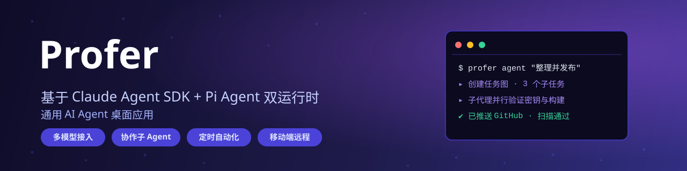
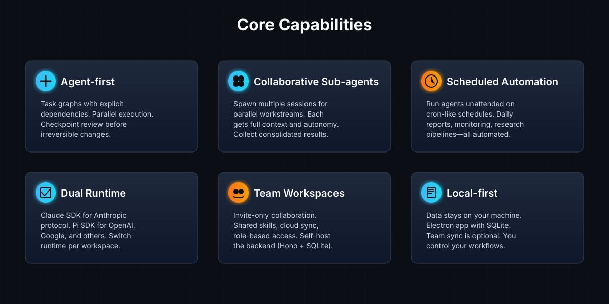
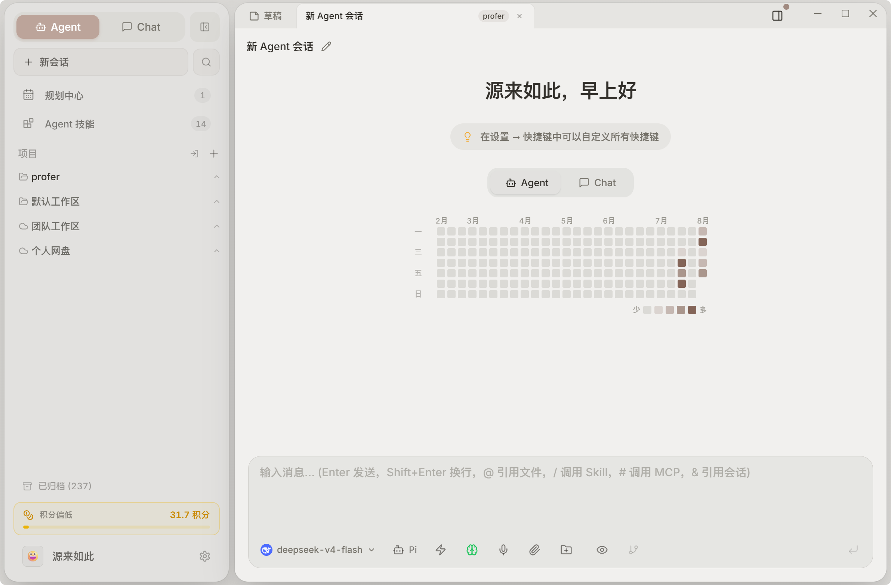
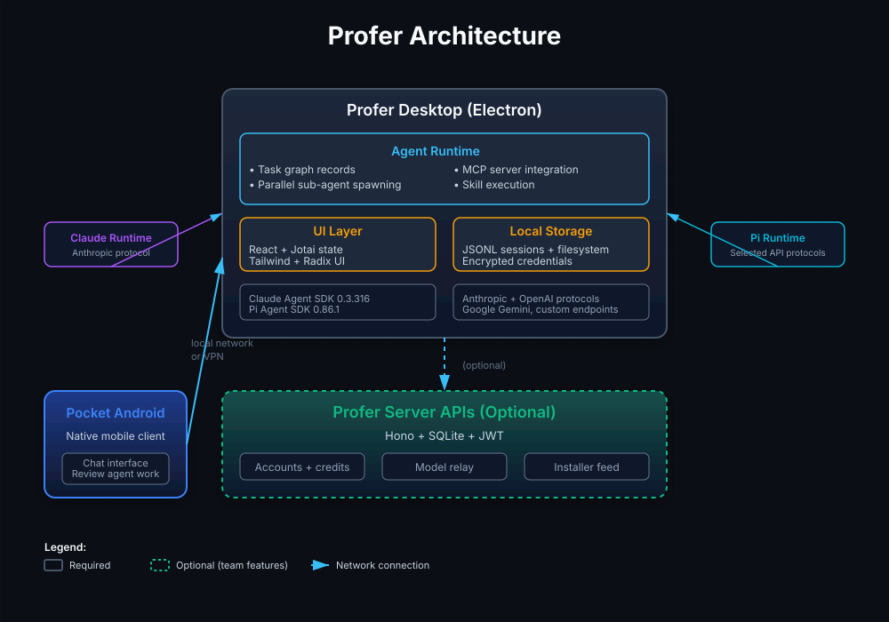
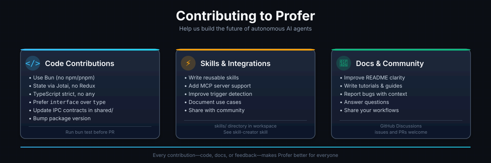

<div align="center">



# Profer

**Your AI workforce in a desktop app**

Built for people who need AI to *do* things, not just chat. Profer runs autonomous agents locally—planning multi-step tasks, coordinating parallel sub-agents, scheduling recurring work—while keeping your data and workflows under your control.

[](https://github.com/Yuan-lai-ru-ci/ProferAI/releases)
[](./LICENSE)
[](https://github.com/Yuan-lai-ru-ci/ProferAI)
[](https://github.com/Yuan-lai-ru-ci/ProferAI/pulls)

[下载 macOS / Windows 版本](https://github.com/Yuan-lai-ru-ci/ProferAI/releases) · [文档](./docs) · [加入社区](#community)

English | [简体中文](./README.zh-CN.md)

</div>

---

## Why Profer?

Most AI tools give you a chatbot. Profer gives you an agent that **executes**, **coordinates**, and **automates**.

- **Chat is for questions.** Agent is for tasks that take hours or require multiple steps.
- **One-shot prompts are brittle.** Profer can record multi-step work and dependencies in a task graph; parallel execution uses explicit sub-agent delegation rather than an automatic DAG-execution guarantee.
- **Recurring work can be scheduled.** Automation runs configured tasks while Profer is running and the required model, tools, and permissions are available; run history records the outcome.

Built on dual runtimes ([Claude Agent SDK](https://github.com/anthropics/claude-agent-sdk) + [Pi Agent SDK](https://www.npmjs.com/package/@earendil-works/pi-agent-core)), Profer provides local session records, configurable permissions, and preset capability gates. Review requirements depend on the selected mode; not every write or Git commit is preceded by a mandatory plan.

---



---

## What makes Profer different

### 🎯 Agent-first, not chat-first

Profer distinguishes simple queries from actual work:

- **Chat mode** for quick questions, brainstorming, document drafts  
- **Agent mode** for multi-step execution: coding, file operations, research synthesis, data pipelines  

Agents can record subtasks and dependencies, delegate independent work to parallel sessions, and request review when the configured mode or tool requires it.

### 🤝 Collaborative sub-agents

Create separate agent sessions for parallel workstreams, with their own model context and execution records. The parent supplies the task and necessary background; children do not automatically receive the full parent transcript. Sessions can share a project directory, so separate context is not filesystem or Git-worktree isolation.

**Example:** Analyzing a codebase? Spawn three agents:  
→ Agent A: scan for security issues  
→ Agent B: profile performance bottlenecks  
→ Agent C: extract architecture diagram  

All run concurrently; you review consolidated findings.

### ⏰ Scheduled automation

Set daily, weekly, monthly, or interval schedules. While Profer is running, the scheduler dispatches due work, records run results, and retries queued triggers when a target session is busy. Long-running work, failures, and sleep/network interruptions still need monitoring.

**Example workflows, with the relevant tools configured:**
→ Generate weekly team status from Git + Jira  
→ Monitor competitor landing pages for changes  
→ Sync research papers to a knowledge base nightly  

### 📱 Mobile companion

Use your phone to trigger desktop agents or review their work. The current mobile maintenance line is the native Android app in the separate [Profer-pocket repo](https://github.com/Yuan-lai-ru-ci/Profer-pocket); its legacy Capacitor app remains a protocol/source reference and is not the native release line. Connections use the local network or VPN—no cloud relay required.

### 🔒 Local-first by default

Workspaces, sessions, skills and files stay on your machine—no account required.

> **2026-10-11 变更**：桌面端内置的团队工作区运行时已移除（产品入口、IPC 与同步链路一并下线），本仓库不再分发团队功能。

---

## Demo



*Example task view. Available actions and review prompts depend on the selected runtime, preset, and permissions.*

---

## Quick start

### 1. Install

Download from [Releases](https://github.com/Yuan-lai-ru-ci/ProferAI/releases):  
- **macOS**: Apple Silicon or Intel DMG  
- **Windows**: 64-bit installer  

Profer checks dependencies on first launch (Git, Node.js or Bun, working shell).

### 2. Connect a model

**Settings → Model Configuration**  

The following summarizes configured channel types, not a live model-availability or end-to-end acceptance matrix. Exact model IDs come from the provider or your channel configuration; Claude runtime requires an Anthropic Messages-compatible endpoint.

| Channel type | Pi default | Claude default | Notes |
|---|---|---|---|
| Anthropic / Anthropic-compatible | Yes | Yes | Anthropic Messages |
| DeepSeek / Ollama | Yes | Endpoint-dependent | Protocol varies with the configured endpoint |
| Kimi API / Kimi Coding / MiniMax | Yes | Yes | Anthropic-compatible Agent endpoint |
| Zhipu general / Zhipu Coding | Yes | Coding by default | Separate provider types |
| Doubao / Ark Coding Plan | Yes | Ark Coding Plan by default | Separate provider types |
| Qwen / Qwen Anthropic | Yes | Anthropic channel by default | Separate provider types |
| Xiaomi / Xiaomi Token Plan | Yes | Yes | Anthropic Messages |
| OpenAI / OpenAI Responses / OpenAI Codex | Yes | No | API or OAuth credentials depend on channel type |
| Google / OpenCode Go OpenAI / custom OpenAI-compatible | Yes | No | Native protocol handled by Pi |
| xAI | Enable Pi; legacy configs require the experimental flag | No | API Key or OAuth channel; Pi-only |

This table describes defaults for channels without an explicit runtime selection. A configured `agentRuntimes` selection takes precedence and a separate `agentBaseUrl` can supply an Anthropic-compatible endpoint; xAI and OpenAI Codex remain Pi-only. See [`provider-capability.ts`](./packages/shared/src/types/provider-capability.ts) for static protocol defaults and [`channel.ts`](./packages/shared/src/types/channel.ts) for runtime and Chat eligibility. Enabled models, credentials, endpoint compatibility, and preset gates determine actual availability. Codex/xAI OAuth credentials are Agent-only, not Chat credentials.

### 3. Start working

- **Chat**: Quick conversations, brainstorming, document editing  
- **Agent**: Complex tasks—coding, file batch operations, research synthesis  

Choose the permission mode and preset before running a task. Planning/review prompts are mode- and tool-specific; they are not a universal approval barrier before every change.

---

## Use cases

### For developers

- **Codebase refactoring**: "Extract all API calls into a service layer, update tests"  
- **Dependency audits**: "List all outdated packages, check for security advisories, propose upgrade plan"  
- **Documentation generation**: "Scan `/src`, extract public APIs, write OpenAPI spec + usage examples"  

### For researchers

- **Literature review**: "Find papers on X published after 2023, extract methodology and datasets, summarize in a table"  
- **Data pipeline**: "Download dataset from Y, clean missing values, run correlation analysis, generate report with plots"  

### For teams

- Schedule recurring summaries from sources available in the workspace
- Monitor pages using configured browser or web tools
- Sync research into a configured knowledge base

These are configurable workflow examples, not built-in Git/Jira, competitor-monitoring, Slack, Notion, or Confluence connectors. Available actions depend on configured tools, MCP servers, and permissions.

---

## Architecture

Profer is a **local-first Electron app**: workspaces, sessions and files stay on your machine.



### Tech stack

- **Runtime**: Bun
- **Desktop**: Electron 43
- **Frontend**: React 18 + TypeScript + Jotai state
- **UI**: Tailwind CSS + Radix primitives
- **Rich content**: TipTap editor, Beautiful Mermaid, KaTeX math, Shiki syntax highlighting
- **Agent SDKs**:
  - [`@anthropic-ai/claude-agent-sdk@0.3.316`](https://github.com/anthropics/claude-agent-sdk)
  - [`@earendil-works/pi-agent-core@0.86.1`](https://www.npmjs.com/package/@earendil-works/pi-agent-core)
- **Mobile**: Native Android is the current maintenance line; the legacy Capacitor app remains in the [Profer-pocket repo](https://github.com/Yuan-lai-ru-ci/Profer-pocket) as a separate historical/protocol reference

---

## Development

Profer is a Bun workspace monorepo:

```text
profer/
├── packages/
│   ├── shared/                # Shared types, IPC contracts, config, utils
│   ├── core/                  # Provider adapters, SSE, syntax highlighting
│   ├── ui/                    # Shared React component library
│   ├── session-core/          # Headless session read / group / search / render
│   ├── session-store/         # Node-only session persistence: index, messages, events, workspace blobs
│   ├── project-core/          # Headless project orchestration: graph build, state replay, query
│   ├── agent-runtime/         # Host-independent agent execution contracts and runtime lifecycle
│   ├── agent-provider-claude/ # Claude Agent SDK provider: query stream, permissions, background tasks
│   ├── agent-provider-pi/     # Pi Agent SDK provider: adapter, message conversion, Pi tools
│   ├── agent-fabric/          # Agent Node / Task Graph / Capability / Policy contracts
│   ├── edition-contract/      # Edition capability contract: account session, managed credentials, edition id
│   ├── office-engine/         # DOCX / PPTX / XLSX dual-plane layout parsing engine
│   └── plugin-api/            # Public contracts for third-party plugins
└── apps/
    ├── electron/              # Electron desktop app
    └── cli/                   # CLI: progressive session reading (list / info / outline / search / export)
```

### Setup

```bash
bun install        # Install dependencies
bun run dev        # Renderer HMR; main/preload changes need an Electron restart
bun run typecheck  # Type check all packages
bun test           # Run tests
```

### Build for production

```bash
cd apps/electron
bun run dist:mac       # macOS binary（当前架构）
bun run dist:win       # Windows installer（需在 Windows 主机执行，见 verify:packaging-host:win）
```

Artifacts appear in `apps/electron/out`.

### Contributing



We welcome PRs! Before submitting:

- Use **Bun** (no npm/pnpm lockfiles)  
- State management via **Jotai**  
- No `any` in TypeScript; prefer `interface` over `type` for object shapes  
- New IPC: update types in `shared/`, handler in `main/`, preload bridge, and renderer call  
- Bump patch version in affected `package.json` when changing package behavior  

See [AGENTS.md](./AGENTS.md) for repository conventions and contribution guidelines.

---

## Team backend (separate repository)

> **2026-10-11 变更**：桌面端团队工作区运行时已移除，本仓库内**没有** `server/` 目录，也不再包含团队后端。

团队后端维护在独立仓库（`profer-server`，Hono + better-sqlite3 + JWT），**不随本公开仓库发布**。如需自托管，请从该独立仓库获取部署说明。

---

## Community

- **GitHub Discussions**: [Ask questions, share workflows](https://github.com/Yuan-lai-ru-ci/ProferAI/discussions)  
- **Issues**: [Report bugs, request features](https://github.com/Yuan-lai-ru-ci/ProferAI/issues)  
- **PRs**: [Contribute code, docs, skills](https://github.com/Yuan-lai-ru-ci/ProferAI/pulls)  

---

## Roadmap

This README does not define approved release dates or a delivery backlog. Consult [open issues](https://github.com/Yuan-lai-ru-ci/ProferAI/issues) and the [documentation lifecycle index](./docs/README.md) for proposals and implementation evidence. A design document or an unchecked historical list is not a shipping commitment. The plugin API already has an implementation and a [maintained guide](./docs/guides/plugins.md); a marketplace and additional platform releases require separate acceptance.

---

## License

Profer is built on [Proma](https://github.com/ErlichLiu/Proma) and licensed under [AGPL-3.0](./LICENSE).  

Commercial licensing available for teams needing proprietary forks—contact us via Issues.

---

## Credits

Built with:

- [Proma](https://github.com/ErlichLiu/Proma) by Erlich Liu  
- [Claude Agent SDK](https://github.com/anthropics/claude-agent-sdk) by Anthropic  
- [Pi Agent SDK](https://www.npmjs.com/package/@earendil-works/pi-agent-core) by Earendil Works  
- [Shiki](https://shiki.style/), [Beautiful Mermaid](https://www.npmjs.com/package/@cuhery/beautiful-mermaid), [Cherry Studio](https://github.com/kangfenmao/cherry-studio), [Lobe Icons](https://lobehub.com/icons)  

---

<div align="center">

**[⬇️ Download Profer](https://github.com/Yuan-lai-ru-ci/ProferAI/releases)** · **[📖 Read the docs](./docs)** · **[⭐ Star this repo](https://github.com/Yuan-lai-ru-ci/ProferAI)**

Made with ❤️ by the Profer team

</div>
