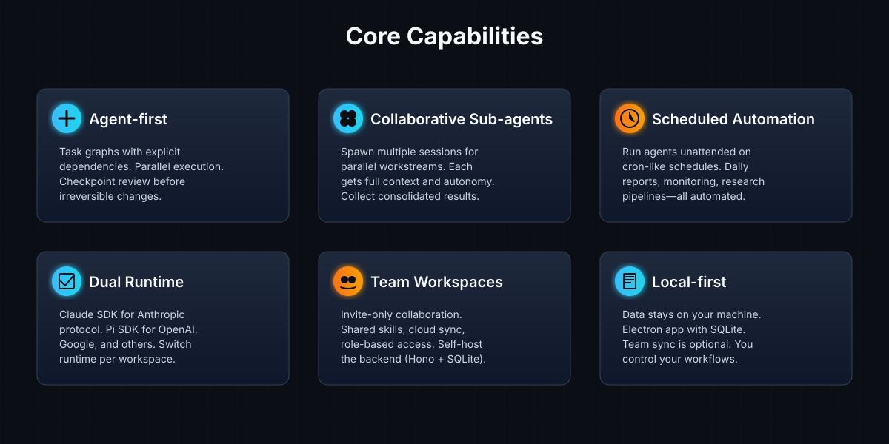
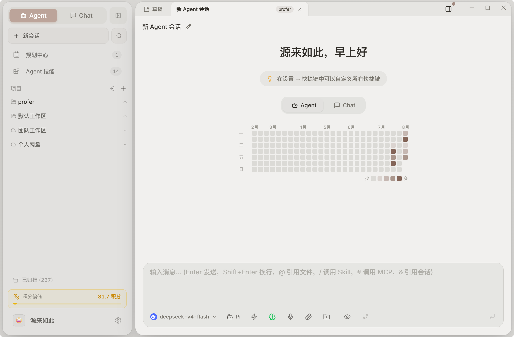
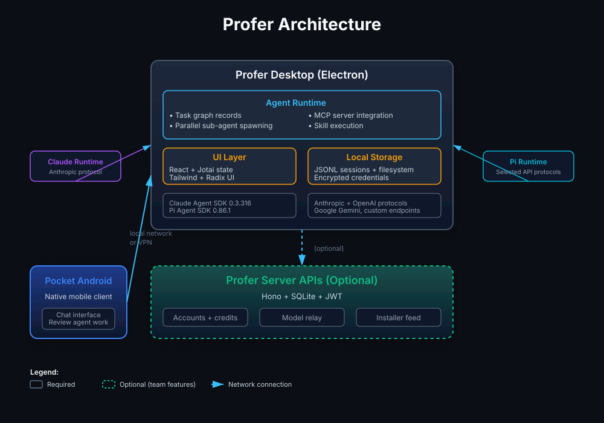
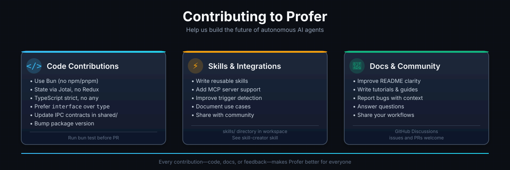

<div align="center">


# Profer

**你的桌面 AI 工作台**

为需要 AI **执行任务**而非仅仅聊天的人而建。Profer 在本地运行自主 Agent——规划多步骤任务、协调并行子 Agent、调度重复性工作——同时让你的数据和工作流保持在自己掌控之中。

[](https://github.com/Yuan-lai-ru-ci/ProferAI/releases)
[](./LICENSE)
[](https://github.com/Yuan-lai-ru-ci/ProferAI)
[](https://github.com/Yuan-lai-ru-ci/ProferAI/pulls)

[下载 macOS / Windows 版本](https://github.com/Yuan-lai-ru-ci/ProferAI/releases) · [文档](./docs) · [加入社区](#社区)

[English](./README.md) | 简体中文

</div>

---

## 为什么选择 Profer？

大多数 AI 工具给你一个聊天机器人。Profer 给你一个能够**执行**、**协调**和**自动化**的 Agent。

- **Chat 用于提问。** Agent 用于需要数小时或多个步骤的任务。
- **单次提示词很脆弱。** Profer 可用任务图记录步骤和依赖；并行执行通过显式子 Agent 委派完成，不保证依赖图自动调度或每次执行成功。
- **重复工作可以调度。** 定时任务在 Profer 保持运行、模型/工具/权限可用时触发，并记录运行结果。

基于双运行时（[Claude Agent SDK](https://github.com/anthropics/claude-agent-sdk) + [Pi Agent SDK](https://www.npmjs.com/package/@earendil-works/pi-agent-core)），Profer 提供本地会话记录、可配置权限与预设能力门禁。审查要求取决于所选模式，并非每次写入或 Git 提交前都会强制展示计划。

---



---

## Profer 的独特之处

### 🎯 Agent 优先，而非聊天优先

Profer 区分简单查询和实际工作：

- **Chat 模式** 用于快速问题、头脑风暴、文档草稿
- **Agent 模式** 用于多步骤执行：编码、文件操作、研究综合、数据管道

Agent 可以记录子任务和依赖，把可独立的工作委派给并行会话，并在配置模式或工具要求时请求审查。

### 🤝 协作式子 Agent

为并行工作创建独立 Agent 会话，分别保存模型上下文和执行记录。父会话须提供任务与必要背景，子会话不会自动获得完整父会话历史；多个会话可能共用项目目录，不能把上下文隔离当作文件系统或 Git worktree 隔离。

**示例：** 分析代码库？生成三个 Agent：
→ Agent A：扫描安全问题
→ Agent B：分析性能瓶颈
→ Agent C：提取架构图

全部并发运行；你审查汇总后的发现。

### ⏰ 定时自动化

可设置每天、每周、每月或按间隔触发的任务。Profer 运行时调度到期工作、记录运行结果，并在目标会话忙碌时保留排队触发；长任务、连续失败、休眠和网络中断仍需观察。

**集成边界：**这些是可配置工作流示例，不代表内置 Git/Jira、竞品监控、Slack、Notion 或 Confluence 专用连接器。实际能力取决于工作区配置的工具、MCP 服务器和权限。

### 📱 移动端伴侣

使用手机触发桌面 Agent 或审查它们的工作。当前移动端维护线是独立 [Profer-pocket 仓库](https://github.com/Yuan-lai-ru-ci/Profer-pocket)中的原生 Android；旧 Capacitor 应用保留为协议/源码参考，不与原生发布线混用。连接通过本地网络或 VPN，无需云端中继。

### 🔒 默认本地优先

工作区、会话、技能与文件全部留在本机——无需注册账号。

> **2026-10-11 变更**：桌面端内置的团队工作区运行时已移除（产品入口、IPC 与同步链路一并下线），本仓库不再分发团队功能。

---

## 演示



*任务视图示例；具体动作和审查提示取决于 Runtime、预设与权限设置。*

---

## 快速开始

### 1. 安装

从 [Releases](https://github.com/Yuan-lai-ru-ci/ProferAI/releases) 下载：

- **macOS：**按 Release 资产选择 Apple Silicon 或 Intel DMG，不假定每次发布都有 universal 包。
- **Windows：**64 位安装包，以所选 Release 实际资产名为准。

### 2. 配置模型

启动 Profer → **设置** → **模型配置**

渠道类型决定可用协议；具体模型 ID 以供应商目录或渠道配置为准，不维护过期的型号清单。Chat 使用渠道配置的对话协议，Agent 则按下表选择 Runtime。

| 渠道类型 | Pi 默认推导 | Claude 默认推导 | 边界 |
|---|---|---|---|
| Anthropic / Anthropic-compatible | 支持 | 支持 | Anthropic Messages |
| DeepSeek / Ollama | 支持 | 取决于端点 | 协议随配置的端点变化 |
| Kimi API / Kimi Coding / MiniMax | 支持 | 支持 | 使用 Anthropic 兼容 Agent 端点 |
| 智谱普通渠道 / 智谱 Coding | 支持 | 默认 Coding 渠道 | 不同 Provider 类型 |
| 豆包 / Ark Coding Plan | 支持 | 默认 Ark Coding Plan | 不同 Provider 类型 |
| 通义千问 / Qwen Anthropic | 支持 | 默认 Anthropic 渠道 | 不同 Provider 类型 |
| Xiaomi / Xiaomi Token Plan | 支持 | 支持 | Anthropic Messages |
| OpenAI / OpenAI Responses / OpenAI Codex | 支持 | 不支持 | API / OAuth 凭据依渠道类型 |
| Google / OpenCode Go OpenAI / 自定义 OpenAI 兼容 | 支持 | 不支持 | Pi 处理各自原生协议 |
| xAI | 需勾选 Pi；旧配置需实验开关 | 不支持 | API Key / OAuth 渠道，Pi-only |

上表只描述未显式勾选 Runtime 时的默认推导；显式 `agentRuntimes` 优先，独立 `agentBaseUrl` 可提供 Anthropic 兼容端点，但 xAI 和 OpenAI Codex 仍只支持 Pi。静态协议归属见 [`provider-capability.ts`](./packages/shared/src/types/provider-capability.ts)，Runtime/Chat 可用性见 [`channel.ts`](./packages/shared/src/types/channel.ts)。这不是在线模型逐项验收清单；实际可用性还受模型启用、凭据、端点与预设门禁约束。Codex/xAI OAuth 订阅凭据仅供 Agent，不可直接用于 Chat。

### 3. 创建工作区

**工作区** = 隔离的环境，带独立的会话历史、技能库和配置。

```text
设置 → 工作区 → 新建工作区
```

为不同项目/客户端/实验使用独立工作区。

### 4. 运行你的第一个 Agent

切换到 **Agent 模式** → 描述任务：

```text
分析 /path/to/repo 的 TypeScript 代码质量。
检查：
- 未使用的导入和变量
- 过于复杂的函数（圈复杂度 > 10）
- 缺少错误处理
- 代码重复模式

生成带建议优先级的 markdown 报告。
```

Agent 将：
1. 扫描仓库
2. 分析代码模式
3. 生成报告
4. 在需要时请求你的审查

---

## 架构

Profer 是一个**本地优先的 Electron 应用**：工作区、会话与文件全部留在本机。



### 目录结构

Profer 是 Bun workspace monorepo：

```text
profer/
├── packages/
│   ├── shared/                # 共享类型、IPC 契约、配置、工具函数
│   ├── core/                  # Provider 适配器、SSE、代码高亮
│   ├── ui/                    # 共享 React 组件库
│   ├── session-core/          # headless 会话读取 / 分组 / 搜索 / 渲染
│   ├── session-store/         # Node-only 会话持久化：索引 / 消息 / 事件 / 工作区资产
│   ├── project-core/          # headless 项目编排：图构建、状态回放、查询
│   ├── agent-runtime/         # 宿主无关的 Agent 执行契约与运行时生命周期
│   ├── agent-provider-claude/ # Claude Agent SDK provider：query 流、权限、后台任务
│   ├── agent-provider-pi/     # Pi Agent SDK provider：适配器、消息转换、Pi 工具
│   ├── agent-fabric/          # Agent Node / Task Graph / Capability / Policy 契约
│   ├── edition-contract/      # 发行版能力契约：账号会话 / 代管凭据 / 发行版标识
│   ├── office-engine/         # DOCX / PPTX / XLSX 双平面版式解析引擎
│   └── plugin-api/            # 第三方插件公开契约
└── apps/
    ├── electron/              # Electron 桌面应用
    └── cli/                   # 命令行：会话渐进式读取（list / info / outline / search / export）
```

### 技术栈

**桌面端（Electron）**
- **Agent Runtime**:
  - [Claude Agent SDK 0.3.316](https://github.com/anthropics/claude-agent-sdk)
  - [Pi Agent SDK 0.86.1](https://www.npmjs.com/package/@earendil-works/pi-agent-core)
  - 任务依赖记录、子 Agent 委派、MCP 集成
- **前端**: React 18 + TypeScript + Jotai（状态）+ Tailwind + Radix UI
- **存储**: 会话使用 JSONL、索引和文件系统；规划数据使用 SQLite；工作区文件留在文件系统
- **IPC**: 类型安全的渲染器 ↔ 主进程通信

**移动端（原生 Android；旧 Capacitor 参考线）**
- 触发桌面 Agent
- 审查结果并继续对话
- 通过本地网络/VPN 连接（无云依赖）

---

## 多模型支持

渠道和 Runtime 的配置边界见上文「配置模型」；完整静态归属以 [`provider-capability.ts`](./packages/shared/src/types/provider-capability.ts) 为准，不在第二张表重复维护模型名或兼容性承诺。本地 Ollama 和自托管端点还需要服务已启动、地址可达，并且模型支持所需的工具调用。

---

## 核心功能

### 1. 任务依赖与协作

任务图用于记录步骤、依赖和状态。例如：

```text
审计当前实现 ──┐
设计新架构 ────┼──→ 实现改造 ──→ 验收
编写测试用例 ──┘
```

Agent 可用任务图工具维护依赖，并显式委派独立工作。图上的依赖不是自动执行调度器，也不证明 A/B/C 已真实并行或完成；结果仍须检查委派记录与验证证据。

### 2. 技能（Skills）

**技能** = 可复用的提示词模板 + 工作流逻辑，存储在工作区中。

**仓库内置 Skill 示例：**`brainstorming`、`writing-plans`、`in-app-browser`、`pdf`、`docx`、`xlsx`。完整清单看 `apps/electron/default-skills/`；实际加载范围由预设、依赖、启用状态和能力门禁决定。代码审查、调研综合、文档生成和测试编写可以作为自定义工作流，不把示例名称当作已内置 Skill。

**创建自定义技能：**
```markdown
# skills/my-skill/SKILL.md

## 触发器
当用户说"优化 SQL 查询"时触发

## 行为
1. 识别仓库中的所有 SQL 查询
2. 运行 EXPLAIN ANALYZE
3. 建议索引/查询重写
4. 基准测试改进前后
```

安装位置：managed 工作区为 `~/.profer/agent-workspaces/<slug>/skills/`，project 工作区为 `<root>/.profer/skills/`。门禁与路由规则见 [`guides/skill-routing.md`](./docs/guides/skill-routing.md)。

### 3. MCP 集成

Profer 支持 [Model Context Protocol](https://modelcontextprotocol.io) 用于工具扩展。

**配置 MCP 服务器：**managed 工作区为 `~/.profer/agent-workspaces/<slug>/mcp.json`，project 工作区为 `<root>/.profer/mcp.json`。

```json
{
  "servers": {
    "filesystem": {
      "command": "npx",
      "args": ["-y", "@modelcontextprotocol/server-filesystem", "/path/to/allowed"]
    },
    "postgres": {
      "command": "npx",
      "args": ["-y", "@modelcontextprotocol/server-postgres", "postgresql://..."]
    }
  }
}
```

配置解析、连接和预设门禁通过后，Agent 才能使用对应工具；配置文件不会自动授予额外权限。

### 4. 上下文管理

Profer 跨执行步骤维护上下文：

- **工作区资料**: 项目背景、偏好、约定
- **会话记忆**: 跨任务的长期事实
- **执行日志**: 每个子任务的完整可审计轨迹

无需在每次提示中重复上下文——Agent 记住。

---

## 使用场景

以下均为工作流示例，需要相应工具、数据源和授权；PR 事件触发、外部知识库同步和合规结论不属于默认内置保证。

### 开发者

- **代码审查辅助**：读取可访问的 diff，给出安全、性能和风格检查建议
- **测试生成**: 为现有函数/组件编写单元测试
- **重构助手**: 建议并应用代码改进（提取函数、移除重复、现代化模式）
- **文档同步**: 在代码更改时保持 README/API 文档更新

### 研究者

- **文献综述**: 抓取论文，提取关键发现，综合跨研究的主题
- **数据管道**: 设置从多个来源（APIs、数据库、文件）获取、清理和聚合的重复任务
- **实验日志**: 自动记录实验参数、结果和统计显著性
- **知识库维护**: 组织笔记、标记概念、建议相关阅读

### 团队与生产力

- **状态报告**: 从 Git 提交 + Jira ticket + Slack 线程生成每周摘要
- **竞争监控**: 每天抓取竞品落地页/定价页，差异高亮
- **客户入职**: 自动生成个性化的入职文档/演示/培训材料
- **合规检查辅助**：按提供的检查表发现待复核问题，不代替 GDPR/HIPAA/SOC2 认证或专业审查

---

## 贡献



我们欢迎 PR！提交前请：

1. **使用 Bun**（不是 npm/pnpm）安装依赖
   ```bash
   bun install
   ```

2. **遵循代码规范**
   - 通过 Jotai 管理状态，不使用 Redux
   - TypeScript strict 模式，避免 `any`
   - 优先使用 `interface` 而非 `type`
   - 在 `packages/shared/` 中更新 IPC 合约

3. **递增版本**
   - 更新 `apps/electron/package.json` 中的版本
   - 如果更改了 IPC 合约，递增 `packages/shared/package.json`

4. **运行测试**
   ```bash
   bun test
   ```

5. **提交信息格式**
   ```text
   feat(scope): 添加功能 X
   fix(scope): 修复问题 Y
   docs: 更新 README
   ```

### 改进建议

请在 Issues 中提交具体问题、复现步骤和验收标准；不要把这里的历史愿望清单当作待开发任务。平台、移动端与导出/导入能力的当前边界，以各维护文档、源码和验收记录为准。

---

## 路线图

本 README 不定义已批准的发版日期或开发排期。旧的 2025 季度与 v0.17/v0.18/v1.0 承诺已经失效，已从现行入口移除；历史文本可从 Git 追溯。

后续方向查 [Issues](https://github.com/Yuan-lai-ru-ci/ProferAI/issues) 和 [文档生命周期索引](./docs/README.md)，设计或交接不等于发布承诺。插件 API 已有实现和[维护指南](./docs/guides/plugins.md)；市场 UI、其他平台发行等仍需各自立项与验收。

---

## 社区

- **GitHub Discussions**: [问答、功能请求、展示你的工作流](https://github.com/Yuan-lai-ru-ci/ProferAI/discussions)
- **Issues**: [报告 bug 或建议改进](https://github.com/Yuan-lai-ru-ci/ProferAI/issues)
- **Pull Requests**: [贡献代码、文档或技能](https://github.com/Yuan-lai-ru-ci/ProferAI/pulls)

---

## 许可证

[GNU AGPL-3.0](./LICENSE)；许可证正文以仓库根 `LICENSE` 为准。

---

## 致谢

Profer 基于以下优秀项目构建：

- [Claude Agent SDK](https://github.com/anthropics/claude-agent-sdk) by Anthropic
- [Pi Agent SDK](https://www.npmjs.com/package/@earendil-works/pi-agent-core) by Earendil Works
- [Model Context Protocol](https://modelcontextprotocol.io) by Anthropic
- [Electron](https://www.electronjs.org) 跨平台桌面框架
- [Bun](https://bun.sh) 快速的 JavaScript 运行时和包管理器
- [React](https://react.dev), [Jotai](https://jotai.org), [Tailwind CSS](https://tailwindcss.com), [Radix UI](https://www.radix-ui.com)

特别感谢所有贡献者和早期采用者的反馈！

---

<div align="center">

**用 Profer 构建？** [在 Discussions 中分享你的工作流](https://github.com/Yuan-lai-ru-ci/ProferAI/discussions) 🚀

</div>
